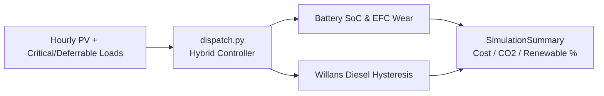

# minigrid-opt

[](https://github.com/codesphere-u/minigrid-opt/actions/workflows/ci.yml)
[](LICENSE)
[](pyproject.toml)
[](pyproject.toml)

**Deterministic hybrid Solar PV + LiFePO4/Lead-Acid battery cycle-life & Willans-line diesel dispatch optimizer with tiered critical-load shedding for rural clinics, schools, and cold-rooms.**

- **Mission Domain:** Energy Efficiency & Renewable Mini-Grids
- **Stack:** Pure Python 3.11+ (zero runtime third-party dependencies, `mypy --strict`, `ruff`, `pytest`)
- **Maintainer:** Codesphere Innovations (U) Limited (`codesphere-u`)

---

## Problem Solved

Off-grid clinics, schools, and cold-rooms destroy expensive battery banks in 18 months through deep-discharge abuse and waste diesel wet-stacking generators at low loads because they lack transparent dispatch planners.

## Key Features

- Hourly hybrid PV -> Battery -> Hysteresis Cycle-Charging Diesel controller preserving critical loads (vaccine fridges, lighting) over deferrable loads.
- Enforces battery SoC protection floors (`LiFePO4` vs `Lead-Acid`), inverter round-trip efficiency, and equivalent full-cycle (EFC) wear valuation.
- Models Willans-line diesel minimum-load fuel consumption (`min_load_frac >= 30%`) and CO₂ emissions (`2.68 kg/L`).

## Architecture Overview



See [docs/architecture.md](docs/architecture.md) for module-level design details.

## Installation

```bash
git clone https://github.com/codesphere-u/minigrid-opt.git
cd minigrid-opt
uv sync --extra dev
```

Or install in editable mode with standard `pip`:

```bash
pip install -e ".[dev]"
```

## Quick Start (CLI)

```bash
minigrid-opt demo
```

## Quick Start (Python API)

```python
from minigrid_opt import BatterySpec, HourlyStepInput, simulate_hybrid_dispatch

steps = [HourlyStepInput(h, pv_kw=5.0 if 7 <= h <= 17 else 0.0, critical_load_kw=1.0, deferrable_load_kw=0.5) for h in range(24)]
rep = simulate_hybrid_dispatch(steps, battery=BatterySpec("lifepo4", 20.0, 0.15))
assert rep.critical_unserved_kwh == 0.0
```

## Testing & Quality Gates

```bash
uv run ruff check src tests
uv run mypy src
uv run pytest -v
```

## Security, Contributing & Roadmap

- **Security:** See [SECURITY.md](SECURITY.md) for responsible disclosure procedures.
- **Contributing:** See [CONTRIBUTING.md](CONTRIBUTING.md) and [CODE_OF_CONDUCT.md](CODE_OF_CONDUCT.md).
- **Changelog & Roadmap:** See [CHANGELOG.md](CHANGELOG.md) and [ROADMAP.md](ROADMAP.md).

## License

MIT License — see [LICENSE](LICENSE).

## Support & Contact

Open an issue on [GitHub Issues](https://github.com/codesphere-u/minigrid-opt/issues) or contact `codesphereinnovationz@gmail.com`.
